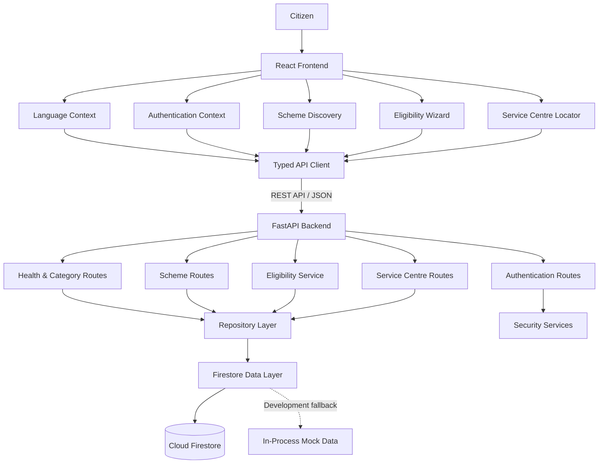

# 🌾 RuralConnect Karnataka

### AI-Ready Government Scheme Discovery & Accessibility Platform

<p align="center">
  <strong>Bridging the Digital Divide • Empowering Rural Communities • Connecting Citizens to Government Welfare</strong>
</p>

<p align="center">
  
  
  
  
  
  
  
</p>

---

## 📌 Overview

**RuralConnect Karnataka** is a bilingual, full-stack web application designed to make government welfare schemes more accessible to rural communities across Karnataka.

Many eligible citizens struggle to discover government schemes, understand eligibility requirements, identify mandatory documents, and locate authorized service centres. RuralConnect addresses these challenges through a centralized, easy-to-use digital platform available in **English and Kannada (ಕನ್ನಡ)**.

The platform brings together scheme discovery, preliminary eligibility assessments, application guidance, and service centre information in one place.

### 🎯 Our Mission

Make government welfare information easier to discover, understand, and access—regardless of a citizen's language or technical knowledge.

### 👥 Target Beneficiaries

* 🌾 **Farmers:** Discover agricultural assistance and welfare programs.
* 🎓 **Students:** Explore educational scholarships and financial assistance.
* 👩 **Women:** Find relevant welfare and empowerment programs.
* 👴 **Senior Citizens:** Discover pension and social security schemes.
* 🏡 **Rural Families:** Access information about housing, healthcare, and other welfare initiatives.

> **Important:** RuralConnect Karnataka is an independent informational platform, not an official government website. Eligibility assessments provide preliminary guidance and do not guarantee approval or benefits.

---

## ✨ Key Features

### 🌐 1. Bilingual User Experience

* Switch between English and Kannada.
* Access localized navigation, instructions, messages, and interface elements.
* View scheme information with English and Kannada titles and descriptions.
* Navigate a responsive interface designed for desktop and mobile devices.

### 🔍 2. Smart Scheme Discovery

Find relevant government welfare programs using:

* Keyword-based search.
* Category filters.
* Beneficiary-type filters.
* Dedicated category shortcuts for farmers, students, women, and other beneficiaries.

### 📋 3. Comprehensive Scheme Details

Each scheme's information page can present:

* Scheme description and benefits.
* Eligibility requirements.
* Mandatory and optional documents.
* Step-by-step application instructions.
* Official application links, where available.
* Information verification dates, where recorded.

### ✅ 4. Interactive Eligibility Checker

A guided assessment helps citizens understand whether they may qualify for a scheme.

**How it works:**

1. Select a government scheme.
2. Answer questions about relevant eligibility criteria.
3. Provide information such as age, income, and other required details.
4. Review the answers before submitting.
5. Receive an assessment with relevant explanations and next steps.

Possible assessment outcomes:

* **Likely Eligible:** The supplied information appears to satisfy the evaluated criteria.
* **Not Eligible:** One or more evaluated requirements are not satisfied.
* **More Information Required:** Additional information is needed to complete the assessment.

The backend evaluates submitted answers against configured eligibility rules and identifies unmet requirements or missing information.

### 📍 5. Government Service Centre Locator

Discover service centre information across Karnataka.

Supported centre types include:

* Grama One
* Karnataka One
* Bangalore One
* Bapuji Seva Kendras

Available directory features include:

* District-based filtering.
* Taluk-based filtering.
* Service centre type filtering.
* Centre addresses and contact information, where available.
* Operating hours, where recorded.
* Google Maps direction links.

**Note:** The accuracy of addresses, contact numbers, operating hours, and scheme information depends on the underlying data. Verify important details with the relevant authority before visiting a centre.

### 🔐 6. Citizen Authentication

The application includes authentication functionality for citizen accounts.

* User registration and login.
* Password hashing with bcrypt.
* Signed JWT authentication tokens.
* Frontend authentication context.
* Session token handling through browser local storage.

Production deployments should additionally use HTTPS, secure token-handling practices, appropriate token expiration, and carefully configured CORS policies.

### ♿ 7. Accessible Information & Public Guidance

* Clear instructions and structured scheme information.
* Responsive layouts for different screen sizes.
* Loading, error, and empty states.
* Explanations of eligibility results.
* Public-facing disclaimers clarifying that final decisions rest with the relevant government departments.

---

## 🖥️ Application Architecture

RuralConnect uses a frontend-backend architecture with a dedicated database access layer.



### Architecture Components

| Component            | Technology               | Responsibility                                  |
| -------------------- | ------------------------ | ----------------------------------------------- |
| Frontend             | React 18, TypeScript     | User interface and application workflows        |
| Build Tool           | Vite                     | Development server and production builds        |
| Styling              | Tailwind CSS 4           | Responsive UI styling                           |
| Navigation           | React Router 6           | Client-side page routing                        |
| API Communication    | Typed REST API client    | Frontend-backend communication                  |
| Backend              | FastAPI                  | HTTP endpoints and application logic            |
| Validation           | Pydantic v2              | Request and response validation                 |
| Authentication       | bcrypt and JWT           | Password hashing and token-based authentication |
| Database             | Firebase Cloud Firestore | Persistent application data                     |
| Database Integration | Firebase Admin SDK       | Backend access to Firestore                     |
| Testing              | pytest, Vitest           | Backend and frontend verification               |

### Request Lifecycle

1. A citizen interacts with the React frontend.
2. The frontend sends an HTTP request through the centralized API client.
3. FastAPI validates the request and dispatches it to the appropriate route.
4. The service and repository layers process the request.
5. Data is retrieved from or written to the configured storage layer.
6. The backend returns a JSON response.
7. The frontend displays the result to the citizen.

---

## 🛠️ Technology Stack

### Frontend

| Technology            | Purpose                                  |
| --------------------- | ---------------------------------------- |
| React 18.3.1          | Component-based user interface           |
| TypeScript 5.6.3      | Type-safe frontend development           |
| Vite 6.4.5            | Development and production build tooling |
| Tailwind CSS 4        | Utility-first styling                    |
| React Router v6       | Client-side routing                      |
| Lucide React          | Interface icons                          |
| Vitest 2.1.8          | Frontend testing                         |
| React Testing Library | Component and interaction testing        |

### Backend

| Technology             | Purpose                         |
| ---------------------- | ------------------------------- |
| Python 3.11+           | Backend programming language    |
| FastAPI                | REST API framework              |
| Uvicorn                | ASGI application server         |
| Pydantic v2            | Data validation and schemas     |
| Pydantic Settings      | Environment-based configuration |
| Firebase Admin SDK     | Firebase integration            |
| Google Cloud Firestore | Cloud document database         |
| bcrypt                 | Password hashing                |
| PyJWT                  | JWT creation and verification   |
| pytest                 | Automated backend testing       |
| HTTPX                  | HTTP testing client             |

---

## 📂 Project Structure

```text
ruralconnect-karnataka/
│
├── frontend/
│   ├── public/
│   ├── src/
│   │   ├── assets/
│   │   ├── components/
│   │   │   ├── common/
│   │   │   ├── layout/
│   │   │   └── schemes/
│   │   ├── contexts/
│   │   ├── hooks/
│   │   ├── pages/
│   │   ├── services/
│   │   ├── test/
│   │   ├── types/
│   │   ├── utils/
│   │   ├── App.tsx
│   │   ├── main.tsx
│   │   ├── index.css
│   │   └── vite-env.d.ts
│   ├── .env.example
│   ├── package.json
│   ├── tsconfig.json
│   ├── vite.config.ts
│   └── README.md
│
├── backend/
│   ├── app/
│   │   ├── core/
│   │   │   ├── config.py
│   │   │   └── security.py
│   │   ├── db/
│   │   │   ├── firebase.py
│   │   │   └── mongodb.py
│   │   ├── models/
│   │   ├── repositories/
│   │   ├── routers/
│   │   ├── schemas/
│   │   ├── services/
│   │   ├── utils/
│   │   └── main.py
│   ├── scripts/
│   │   └── seed_data.py
│   ├── tests/
│   ├── .env.example
│   ├── pytest.ini
│   ├── requirements.txt
│   └── README.md
│
├── .gitignore
└── README.md
```

---

## ⚙️ Installation & Local Setup

Follow these instructions to run RuralConnect Karnataka locally on Windows.

### Prerequisites

Install the following tools:

* **Python 3.11 or newer**
* **Node.js and npm**
* **Git**
* A Firebase project with Cloud Firestore enabled for persistent database storage

> The project also includes a development fallback in its database layer. Confirm the actual fallback behavior and Firebase configuration in the source code before relying on it. Mock fallback data should not be treated as persistent production storage.

### Step 1: Clone the Repository

If you have not cloned the project yet:

```powershell
git clone YOUR_GITHUB_REPOSITORY_URL
cd ruralconnect-karnataka
```

Replace `YOUR_GITHUB_REPOSITORY_URL` with your actual GitHub repository URL.

If the project is already on your computer, navigate directly to its root directory:

```powershell
cd "C:\Users\NAVEEN ASUNDI\.gemini\antigravity\scratch\ruralconnect-karnataka"
```

### Step 2: Configure the Backend

Navigate to the backend directory:

```powershell
cd backend
```

Create a virtual environment:

```powershell
python -m venv .venv
```

Activate the environment:

```powershell
.\.venv\Scripts\Activate.ps1
```

If PowerShell blocks script execution, you can activate the environment using Command Prompt instead:

```bat
.venv\Scripts\activate.bat
```

Install dependencies:

```powershell
python -m pip install --upgrade pip
pip install -r requirements.txt
```

### Step 3: Configure Environment Variables

Create your local environment file from the provided example:

```powershell
Copy-Item .env.example .env
```

Open `.env` and configure the required settings according to `app/core/config.py`.

Typical configuration categories include:

* Application environment.
* JWT signing secret.
* JWT expiration settings.
* CORS allowed origins.
* Firebase project and credential configuration.
* Database and logging settings, if supported by the implementation.

**Security requirements:**

* Never commit `.env` or Firebase service-account credentials.
* Use a unique, strong JWT signing secret.
* Use separate development and production secrets.
* Restrict CORS to the actual frontend origins.
* Prefer a secure cloud identity or supported application credential mechanism for production Firebase access.

The exact environment variable names must match the settings defined in the backend source code.

### Step 4: Configure Firestore

1. Create or select a Firebase project.
2. Enable Cloud Firestore.
3. Configure backend authentication using an appropriate Firebase Admin SDK credential mechanism.
4. Set the required Firebase environment variables or application credentials.
5. Verify that the backend can access the expected collections.

The application architecture identifies these collections:

* `schemes`
* `centers`
* `users`

Verify the repository implementation for the actual collection names and document structure.

### Step 5: Seed Development Data

From the `backend` directory, run:

```powershell
python scripts\seed_data.py
```

This script is intended to populate initial development data.

Check the terminal output for successful completion. If the script requires Firestore access, confirm your Firebase credentials and permissions first.

**Important:** Seed scripts should be reviewed before running them against production databases.

### Step 6: Start the Backend Server

From the `backend` directory:

```powershell
python -m uvicorn app.main:app --reload --host 127.0.0.1 --port 8000
```

The backend should be accessible at:

| Resource                  | URL                                 |
| ------------------------- | ----------------------------------- |
| API Base URL              | http://127.0.0.1:8000/api/v1        |
| Swagger API Documentation | http://127.0.0.1:8000/docs          |
| ReDoc Documentation       | http://127.0.0.1:8000/redoc         |
| Health Check              | http://127.0.0.1:8000/api/v1/health |

Keep this terminal running.

### Step 7: Configure the Frontend

Open a second terminal and navigate to the project:

```powershell
cd "C:\Users\NAVEEN ASUNDI\.gemini\antigravity\scratch\ruralconnect-karnataka\frontend"
```

Install the frontend dependencies:

```powershell
npm install
```

Create the local environment file:

```powershell
Copy-Item .env.example .env
```

Configure the frontend API URL according to the variables used in the source code. For example, if the application uses `VITE_API_URL`:

```env
VITE_API_URL=http://127.0.0.1:8000/api/v1
```

Only use this variable name if it matches the frontend's API configuration.

Start the development server:

```powershell
npm run dev
```

Open the local URL printed in the terminal. With the default Vite configuration, this is usually:

**http://127.0.0.1:5173**

### Step 8: Verify the Application

Check the following:

* [ ] The backend starts without errors.
* [ ] The health endpoint returns a successful response.
* [ ] The frontend loads correctly.
* [ ] English and Kannada switching works.
* [ ] Scheme search and category filters work.
* [ ] Scheme detail pages display the expected information.
* [ ] Eligibility questions and assessments work.
* [ ] Service centre filters work.
* [ ] Registration and login behave correctly.
* [ ] No unexpected API, CORS, or database errors appear in the browser console.

---

## 🔌 API Overview

The backend exposes versioned REST API routes under:

```text
/api/v1
```

The following table summarizes the documented API route groups. Exact HTTP methods, query parameters, request schemas, and response formats should be verified in the implementation or Swagger documentation.

| Endpoint                                 | Purpose                             |
| ---------------------------------------- | ----------------------------------- |
| `/api/v1/health`                         | Check backend health                |
| `/api/v1/categories`                     | Retrieve scheme categories          |
| `/api/v1/schemes`                        | Browse and search schemes           |
| `/api/v1/schemes/{id}/check-eligibility` | Evaluate eligibility for a scheme   |
| `/api/v1/centers`                        | Retrieve service centre information |
| `/api/v1/auth`                           | Authentication-related routes       |

### Explore the API

After starting the backend, open:

**http://127.0.0.1:8000/docs**

Swagger UI allows you to inspect available routes, review schemas, submit test requests, and examine API responses.

> The endpoint table describes route groups from the project architecture. It does not imply that every route has been independently verified or that all operations use a particular HTTP method.

---

## 🧪 Testing & Quality Assurance

RuralConnect includes automated testing for backend behavior and frontend components.

### Backend Tests

Activate the virtual environment and navigate to `backend`:

```powershell
python -m pytest -v tests
```

The documented test coverage includes:

* Health endpoint.
* Scheme listing and details.
* Category filtering.
* Text search.
* Pagination.
* Document information.
* Eligibility questions and assessments.
* Missing mandatory information.
* Service centre directory and district filtering.
* User registration.
* Duplicate registration rejection.
* Login authentication.
* Invalid password rejection.

The project documentation reports **19 passing backend tests** for the described test suite.

This result is a documented baseline, not a guarantee that the current checkout passes. Run the command above to verify the current code.

### Frontend Tests

Navigate to the `frontend` directory:

```powershell
npm test
```

The documented frontend test coverage includes:

* Navigation.
* Language switching.
* Scheme card rendering.
* Homepage controls.

Confirm the available test scripts in `frontend/package.json`. If `npm test` is not configured, use the test command defined by the project.

### Production Build

From the `frontend` directory:

```powershell
npm run build
```

This checks TypeScript compilation and generates the frontend production build, assuming the script is configured as documented.

### Recommended Verification Workflow

Run all three checks before pushing significant changes:

```powershell
# Backend
cd backend
python -m pytest -v tests
```

```powershell
# Frontend tests
cd frontend
npm test
```

```powershell
# Frontend production build
npm run build
```

---

## 🔒 Security Considerations

Security is important because the application may handle personal information and account credentials.

The project incorporates password hashing and JWT-based authentication. Before production deployment, verify the following:

* Passwords are never stored in plaintext.
* JWT signing secrets are strong, private, and environment-specific.
* Token expiration and verification are enforced by the backend.
* Protected routes enforce authentication and authorization server-side.
* CORS allows only the intended origins.
* All production traffic uses HTTPS.
* Firebase credentials are not committed to GitHub.
* Firestore access follows least-privilege principles.
* User data is not exposed through public endpoints or error messages.
* Input validation is applied to all relevant API requests.
* Rate limiting or equivalent abuse controls protect authentication endpoints.
* Logs do not expose passwords, authentication tokens, or unnecessary personal information.

### Privacy Principle

Collect only the information necessary for the requested functionality. Explain how personal data is used, protect it appropriately, and avoid storing sensitive eligibility answers unless required.

---

## 🚀 Deployment Readiness

RuralConnect is structured as a separate frontend and backend application, making independent deployment possible.

The following are potential hosting options, not claims that the application is already deployed.

| Component       | Possible Hosting Option                                        |
| --------------- | -------------------------------------------------------------- |
| React frontend  | Vercel, Netlify, or another static hosting provider            |
| FastAPI backend | Render, Railway, or another Python-compatible hosting provider |
| Database        | Firebase Cloud Firestore                                       |
| Source code     | GitHub                                                         |

### Frontend Deployment Checklist

1. Build the frontend using `npm run build`.
2. Configure the production API URL.
3. Add the required environment variables to the hosting provider.
4. Deploy the frontend.
5. Verify navigation, language switching, and API requests.
6. Confirm that the deployed frontend uses HTTPS.

### Backend Deployment Checklist

1. Configure the production Python environment and dependencies.
2. Set the correct ASGI application entry point.
3. Configure Firebase credentials securely.
4. Set a strong JWT signing secret.
5. Configure the production CORS origins.
6. Confirm database access and health checks.
7. Deploy the application.
8. Test the deployed API using Swagger UI or an HTTP client.

### Production Database

Use persistent Firestore storage for production data. Do not rely on in-process mock data as a persistent database.

If the database layer silently falls back to mock data when a connection fails, review that behavior before deployment. Production systems should clearly distinguish database failures from successful responses containing development data.

### Environment Configuration

Frontend and backend environment variables serve different purposes.

**Frontend:**

* Public API base URL.
* Other explicitly supported public configuration values.

**Backend:**

* JWT signing secret.
* Firebase credentials or identity configuration.
* CORS allowed origins.
* Application environment.
* Other settings defined in the backend configuration.

Never put private backend secrets in frontend variables prefixed with `VITE_`, because those values can be exposed in the browser bundle.

---

## 🗺️ Future Enhancements

Potential improvements include:

* 🤖 AI-assisted scheme discovery using verified government information.
* 🎯 More personalized scheme recommendations.
* 🗣️ Voice-assisted navigation for citizens with limited literacy.
* 📱 Progressive Web App support.
* 🔔 Notifications about application deadlines and relevant scheme updates.
* 🏛️ Integration with verified official government data sources.
* 📊 Administrative dashboards for scheme and directory maintenance.
* 🌍 Additional Indian language support.
* ♿ Expanded accessibility testing and screen-reader improvements.
* 📡 Better handling of low-bandwidth and unreliable network connections.
* 🔎 More detailed scheme provenance, source links, and last-verified dates.
* 🧪 Expanded integration, security, and end-to-end testing.

These are proposed enhancements and should not be interpreted as existing functionality.

---

## 🤝 Contributing

Contributions, suggestions, and bug reports are welcome.

### How to Contribute

1. Fork the repository.
2. Create a feature branch.
3. Make your changes.
4. Run the relevant tests.
5. Commit your changes with a descriptive message.
6. Push the branch to GitHub.
7. Open a pull request describing the changes.

Example:

```bash
git checkout -b feature/improve-scheme-search
git add .
git commit -m "Improve scheme search and filtering"
git push origin feature/improve-scheme-search
```

For substantial changes, explain the problem being addressed and include testing instructions.

---

## 👨‍💻 Project Information

**Project Name:** RuralConnect Karnataka
**Kannada Name:** ರೂರಲ್ ಕನೆಕ್ಟ್ ಕರ್ನಾಟಕ
**Project Type:** Full-Stack Web Application
**Domain:** Digital Governance, Social Welfare & Rural Accessibility
**Frontend:** React, TypeScript, Vite, Tailwind CSS
**Backend:** Python, FastAPI, Pydantic
**Database:** Firebase Cloud Firestore
**Languages:** English and Kannada

**Repository:** Add your GitHub repository URL here.

**Live Demo:** Add your deployed application URL when deployment is complete.

**API Documentation:** Add your deployed Swagger URL after the backend is deployed.

---

## ⚖️ Disclaimer

RuralConnect Karnataka is an independent informational platform developed to improve the discoverability and accessibility of government welfare information.

It is not affiliated with, endorsed by, or operated by the Government of Karnataka or the Government of India unless an official partnership is separately established.

Scheme information and eligibility assessments are provided for general guidance. Eligibility results depend on the accuracy and completeness of the available data and the rules implemented in the application.

**A preliminary eligibility result does not guarantee that an applicant will receive a benefit.** Final eligibility verification, application processing, and approval are the responsibility of the relevant government departments and authorized authorities.

Users should consult official government sources or authorized service centres to confirm current eligibility conditions, required documents, deadlines, and application procedures.

---

<p align="center">
  <strong>🌾 RuralConnect Karnataka — Making Government Welfare More Accessible, One Citizen at a Time.</strong>
</p>
